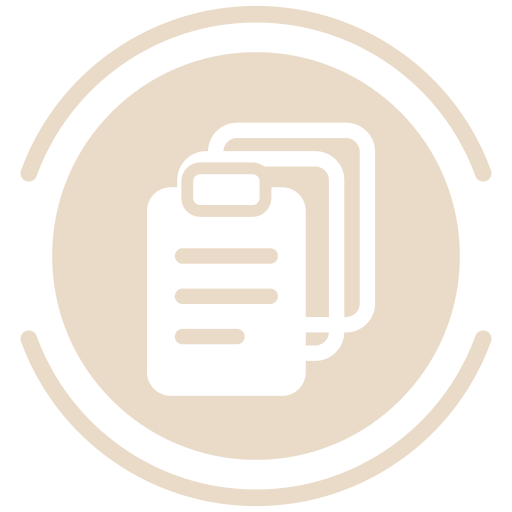
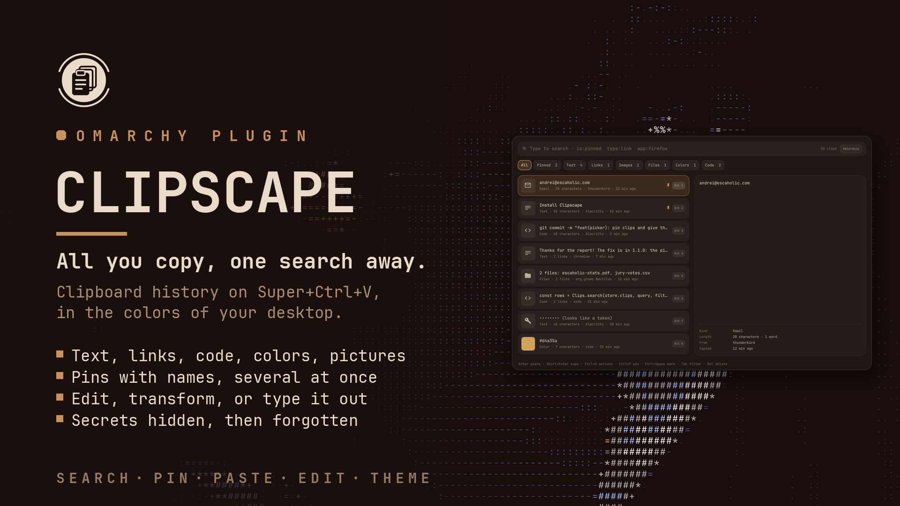
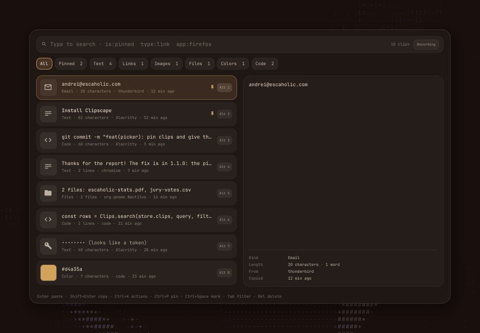
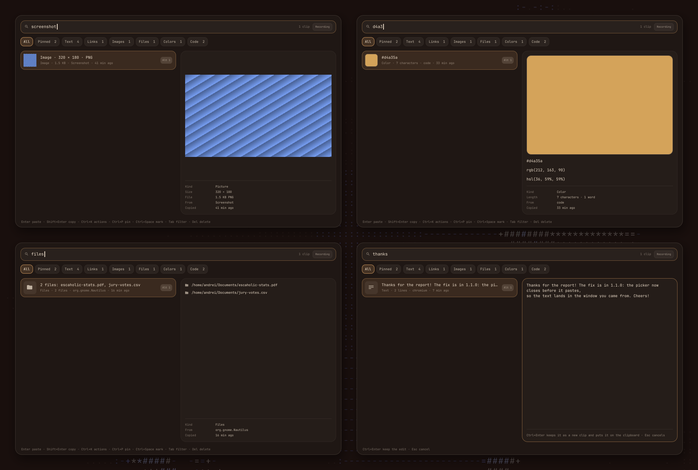
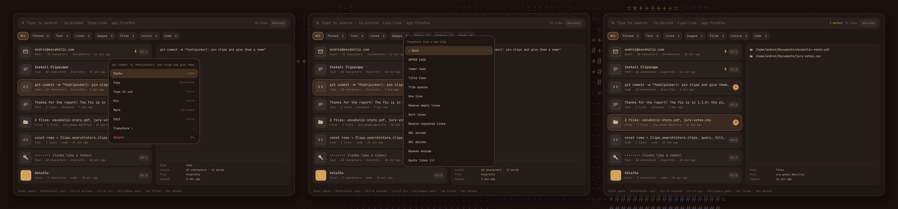
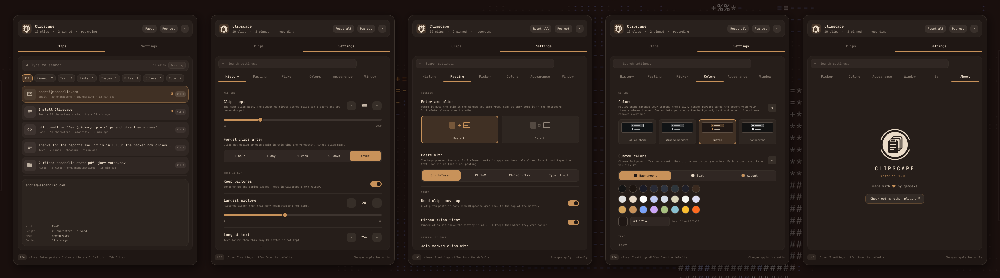

<p align="center">
  <picture>
    <source media="(prefers-color-scheme: light)" srcset="assets/logo-dark.png">
    
  </picture>
</p>

<h1 align="center">Clipscape</h1>

<p align="center">All you copy, one search away: clipboard history for <a href="https://omarchy.org">Omarchy</a>, on Super+Ctrl+V.</p>



Omarchy keeps a clipboard history on **Super+Ctrl+V**: a list you can search, then Enter puts a clip back. Clipscape takes over that key and that list, and keeps much more. Every text, link, piece of code, color, file and picture you copy is kept, and you find it by typing a few letters. Pin the clips you paste every day and give them a name, paste several at once, fix a clip before you paste it, or type it out where pasting is blocked. Passwords and tokens are hidden and forgotten. It all comes in your theme's colors, with a bar button and a panel where every setting lives.

## Features

- **Search as you type**: words anywhere in a clip, its first letters ("gst" finds `git status`), and `is:pinned`, `type:link` or `app:firefox` to narrow it.
- **Every kind of copy**: text, links, emails, numbers, code, colors, copied files and pictures, each with its own icon, thumbnail or swatch, and filters to show just one kind.
- **A preview of the whole clip**: all of the text, the picture at its size, a color in hex, rgb and hsl, the list of files, and where and when it was copied.
- **Pins**: pinned clips stay on top in your own order, never expire and survive clearing; give them a name to find them by.
- **Several at once**: mark clips with Ctrl+Space and Enter pastes them together, in the order you marked them.
- **Edit and transform**: change a clip before you paste it, or turn it into upper case, one line, formatted JSON, a Markdown link and more. The original stays.
- **Paste where you were**: Enter pastes into the window you came from; Shift+Enter only copies; Type it out types the text for fields that block pasting.
- **Private**: copies a password manager marks as secret are never kept, apps you list are skipped, and clips that look like passwords, tokens, keys or card numbers are hidden and forgotten after a few minutes. Pause it whenever you like.
- **Your theme**: follows your Omarchy theme live, or your window border's colors, your own colors, or none at all; in a bar panel or its own window.

### The picker



**Super+Ctrl+V** opens the picker, in the middle of the screen or at the mouse. Type to search, move with the arrows, and Enter pastes the selected clip into the window you were in. The first nine rows show **Alt+1** to **Alt+9**, which paste that row straight away. **Tab** steps through the filters: All, Pinned, Text, Links, Images, Files, Colors and Code.

### Previews



The pane beside the list shows the whole of the selected clip. **Ctrl+E** turns a text clip into a field you can change; **Ctrl+Enter** keeps the edit as a new clip and puts it on the clipboard, and the original stays as it was.

### Actions, transforms and marking



**Ctrl+K** (or a right click) opens everything you can do with a clip, with the key that does the same without the menu. **Transform** makes a new clip from the selected one: UPPER CASE, lower case, Title Case, trimmed, on one line, without empty or repeated lines, sorted, formatted or minified JSON, URL encoded or decoded, Base64 encoded or decoded, a Markdown link or quoted lines.

## Installation

```bash
omarchy plugin add https://github.com/qempexe/omarchy-clipscape.git --enable --yes
omarchy restart shell
```

Clipscape stands in for Omarchy's own clipboard plugin, so **Super+Ctrl+V** and **Clipboard** in the Omarchy menu open it, with no keybinding to add. The bar button goes to the right of the bar; move it from the bar settings, or with `{ "id": "io.github.qempexe.clipscape" }` under `bar` → `layout` in `~/.config/omarchy/shell.json`.

The first time it runs, it brings in the history Omarchy already kept, pictures too. Everything it needs comes with Omarchy: `wl-clipboard`, `wtype`, `python3` and `hyprctl`.

## Usage

### The picker

| Key | Does |
| --- | --- |
| Type, Backspace, Ctrl+U | search, delete a letter, clear the search |
| ↑ ↓, Page Up/Down, Home, End | move |
| Enter | paste (or copy, see **Enter and click**) |
| Shift+Enter | copy (or paste) |
| Alt+1 … Alt+9 | paste that row |
| Alt+Enter | open the link, or show the copied file's folder |
| Ctrl+T | type it out |
| Ctrl+K, right click | the actions menu (→ for transforms) |
| Ctrl+P | pin or unpin |
| Ctrl+R | name a pinned clip |
| Ctrl+↑ Ctrl+↓ | move a pinned clip up or down |
| Ctrl+Space | mark; Enter then pastes all marked clips together |
| Ctrl+E | edit, then Ctrl+Enter keeps it |
| Ctrl+H | show or hide secrets |
| Tab, Shift+Tab | next or previous filter |
| Delete | delete the clip (or the marked ones) |
| Shift+Delete | clear the history; pinned clips stay |
| Esc | unmark, clear the search, then close |

A click pastes a row, a right click opens its menu, and **Recording** in the search bar pauses and resumes.

### Bar button

| Click | Does |
| --- | --- |
| Left | opens the panel, or closes it |
| Right | the panel on Settings |
| Middle | opens the picker (or pauses, see **Middle click**) |

The panel's **Clips** tab is the same history with the same keys. **Pause** in its header stops recording; while paused nothing reads the clipboard at all. **Pop out** turns the panel into a window you can move, resize and tile, and **Dock** puts it back.

### From a terminal

```bash
omarchy-shell io.github.qempexe.clipscape picker        # open the picker
omarchy-shell io.github.qempexe.clipscape paste 2       # paste the second newest clip
omarchy-shell io.github.qempexe.clipscape copy 1        # copy the newest clip
omarchy-shell io.github.qempexe.clipscape togglePause   # or pause, resume
omarchy-shell io.github.qempexe.clipscape status
```

## Configuration

The **Settings** tab, or a right click on the bar button. Everything applies at once and is saved in `~/.local/state/omarchy-clipscape/settings.json`.



The settings sit in tabs, with a search box above them that looks through every tab. Each changed row gets a **↺** to put it back, and **Reset all** in the header puts back everything.

| Tab | Setting | Default | |
| --- | --- | --- | --- |
| History | Clips kept | 500 | 50 to 2000; pinned clips don't count |
| | Forget clips after | Never | 1 hour, 1 day, 1 week or 30 days without being used |
| | Keep pictures, Largest picture | on, 20 MB | |
| | Longest text | 256 KB | |
| | Never keep copies from | keepassxc, bitwarden, 1password, proton pass | apps by window class |
| | Clips that look like secrets | Hide and forget | or Don't keep, or Keep as is |
| | Forget secrets after | 10 min | |
| | Clear a pasted secret after | off | 5 to 120 seconds |
| Pasting | Enter and click | Paste it | or Copy it |
| | Paste with | Shift+Insert | or Ctrl+V, Ctrl+Shift+V, Type it out |
| | Used clips move up | on | |
| | Pinned clips first | on | |
| | Join marked clips with | New line | or Space, or Nothing |
| Picker | Opens | In the middle | or At the mouse |
| | Picker width, height | 860 × 560 | |
| | Darken behind | 30 | 0 to 80 |
| | Preview | on | |
| | Rows | Two lines | or One line |
| | App names, Numbers 1 to 9 | on, on | |
| | Opens on | All | or Pinned, or The last filter |
| Colors | Colors | Follow theme | Follow theme, Window borders, Custom or Monochrome |
| | Custom colors | | background, text and accent, used exactly as you pick them |
| | Text | Always readable | or Theme, or My text color |
| Appearance | Row style, Spacing | Soft, Comfortable | |
| | Roundness, Text size | 4, 1 | |
| Window | Panel width, height | 520 × 640 | |
| | Open as | Bar panel | or Own window |
| | Window outline | off | the edge in your window border's colors, as a gradient or one color |
| | Window tint, Window opacity | 0, 97 | |
| Bar | Bar button shows | Icon | or Icon and count, or Icon and last clip (never a secret) |
| | Middle click | Open the picker | or Pause or resume, or Nothing |

**About**, the last tab, has the logo, the version and a link to more plugins.

Hyprland tiles new windows. To float the popped-out panel, add to `~/.config/hypr/hyprland.lua`:

```lua
o.window({ class = "^org\\.quickshell$", title = "^Clipscape$" }, { tag = "+clipscape-window" })
o.window({ tag = "clipscape-window" }, { float = true })
o.window({ tag = "clipscape-window" }, { center = true })
o.window({ tag = "clipscape-window" }, { size = { 520, 640 } })
```

## Troubleshooting

- **Super+Ctrl+V opens Omarchy's old picker.** Clipscape has to be enabled for the key to move over: `omarchy plugin enable io.github.qempexe.clipscape`, then `omarchy restart shell`.
- **Pasting lands nowhere.** The picker closes first and the paste goes to the window that gets the focus back. In an app that ignores Shift+Insert, pick another **Paste with**, or Ctrl+T to type it out.
- **A copy is missing.** It may be paused (the bar button shows ⏸), from an app in **Never keep copies from**, marked secret by a password manager, too long or too big, or a secret with **Don't keep**.
- **A clip shows as dots.** It looked like a password, a token, a key or a card number. Ctrl+H shows it until the picker closes; pin it to keep it beyond **Forget secrets after**, or set **Clips that look like secrets** to Keep as is.
- **Where things live.**

  | Path | Contents |
  | --- | --- |
  | `~/.local/state/omarchy-clipscape/history.json` | the clips |
  | `~/.local/state/omarchy-clipscape/images/` | the pictures, named by their SHA-256 |
  | `~/.local/state/omarchy-clipscape/settings.json` | your settings |

  The folder is readable by you alone (0700). Pictures no clip uses any more are deleted.
- **Network.** None. Nothing leaves your computer.
- **How copying works.** One `wl-paste --watch` hands each copy to Clipscape's helper, which reads it with a size limit and a time limit, and only then. Putting a clip back goes through `wl-copy` on its stdin, never as an argument, and the keys are pressed by `wtype`.

## Contributing

Bug reports and ideas are welcome as [issues](https://github.com/qempexe/omarchy-clipscape/issues). [CONTRIBUTING.md](CONTRIBUTING.md) explains how to add a setting, a filter or a transform, the rules and the tests. Everyone taking part is expected to follow the [code of conduct](CODE_OF_CONDUCT.md). What changed in each version is in the [changelog](CHANGELOG.md).

### Source layout

```
qml/
├── Service.qml       settings, colors, the theme's window border, ipc
├── Picker.qml        the picker on Super+Ctrl+V
├── BarWidget.qml     the bar button, docking and popping out
├── core/             ClipStore (the history, the watcher, putting clips back),
│                     SettingsStore, UiState (colors, spacing, the open tab)
├── picker/           ClipView (search, list, keys), ClipRow, KindIcon, PreviewPane,
│                     ActionMenu
├── panel/            Panel, PopoutWindow, PanelView, SettingsView + SettingRow +
│                     TileArt, AboutPage
├── controls/         Btn, Chip, Sw, TextBox, Txt, Frame
└── js/               Clips.js (kinds, secrets, search, transforms), Schema.js (every
                      setting), Theme.js (border colors)
bin/clipscape         the helper: capture, copy, gc, import, secure
assets/               the logo, light and dark
tests/                node tests/test_model.js, python3 tests/test_helper.py
```

### Upgrading and uninstalling

```bash
omarchy plugin update io.github.qempexe.clipscape
omarchy restart shell
```

```bash
omarchy plugin remove io.github.qempexe.clipscape
omarchy restart shell
rm -rf ~/.local/state/omarchy-clipscape   # the history and the settings, if you want them gone
```

Removing it gives Super+Ctrl+V back to Omarchy's own clipboard history, which carries on with what it kept before.

## License and credits

[MIT](LICENSE).

- Copies are read with [wl-clipboard](https://github.com/bugaevc/wl-clipboard) and pasted with [wtype](https://github.com/atx/wtype).
- Thanks to the **Omarchy** project for the shell, its plugin system and the clipboard history Clipscape builds on, to **Hyprland**, and to **Quickshell** and **Qt** for the toolkit.
- Thanks to everyone who tests it and reports issues.

Clipscape is an independent community plugin. It is not affiliated with or endorsed by Omarchy.
